# Compiled GDScript Bytecode (`.gdb`) & Stripped Export Templates Design

> [!NOTE]
> This design covers **Phase 1** (compiled `.gdb` bytecode export, isolated export compilation, fatal export error handling, normative wire format, loading, linking, and verification) and **Phase 2** (optional front-end stripping for export templates via `gdscript_frontend=no`). Whole-program symbol mangling is out of scope for this document and can be layered on later without changing the `.gdb` wire format.

## 1. Problem & Goals

### Problem
Today, Godot's export plugin ([`EditorExportGDScript`](file:///Users/christian/CafecitoGames/godot/modules/gdscript/register_types.cpp#L83-L121)) ships GDScript as `.gdc` binary token streams via [`GDScriptTokenizerBuffer`](file:///Users/christian/CafecitoGames/godot/modules/gdscript/gdscript_tokenizer_buffer.cpp) (default `MODE_SCRIPT_BINARY_TOKENS_COMPRESSED`). Because `.gdc` is a lossless token stream:
1. Exported games still pay runtime parse, static-analysis, and bytecode-compilation costs on script load.
2. Source-level structure, comments, formatting, and function-local names ship (or are trivially reconstructed) from `.gdc`.
3. Export templates must ship the entire GDScript compiler front-end (tokenizer, parser, analyzer, compiler, codegen).

### Goals
- **Phase 1 — Compiled Bytecode Export (`.gdb`):** Add an export script mode (`MODE_SCRIPT_COMPILED_BYTECODE`) where the editor compiles scripts in an **isolated export compilation session** and serializes the compiled `GDScript` object graph. At runtime, the game deserializes, verifies, and links `.gdb` files without running the tokenizer, parser, analyzer, or compiler.
- **Phase 2 — Front-End Stripping (`gdscript_frontend=no`):** Add an SCons option that compiles export templates without the GDScript front-end (`GDSCRIPT_NO_FRONTEND`), reducing binary size and guaranteeing that stripped runtimes load precompiled `.gdb` exclusively.
- **Upstream Fork Hygiene:** Keep the vast majority of new code in self-contained files under `modules/gdscript/`, with minimal surgical hooks in existing Godot files so upstream Godot rebases remain manageable.

### What `.gdb` Omits vs. Retains (Security & Scope Contract)
`.gdb` is **not** cryptographic source protection or confidentiality. VM bytecode still exposes control flow, literal constants, engine API calls, and symbol names sufficient for a purpose-built disassembler or decompiler. It omits source text, comments, formatting, function-local variable names (`stack_debug`), and release-stripped `assert`/`breakpoint`/line opcodes, improving load time and raising the reverse-engineering bar.

Specifically, an unmangled `.gdb` **retains**:
- Member, method, class, constant, enum, and signal names used by name-dispatched opcodes (`global_names`) and class metadata.
- `MethodInfo` names and **parameter names** (`MethodInfo::arguments[]` — retained for reflection, `Callable`, RPC, and inspector/method-list parity).
- String / `StringName` / `NodePath` literal constants.
- Engine API names inside symbolic pointer-fixup keys.

And `.gdb` **omits**:
- Original source text, comments, indentation/formatting, and AST/token streams.
- Function-local variable names (`stack_debug` is never serialized — including in debug exports, meaning remote local-variable inspection is intentionally unavailable for `.gdb`-exported builds even when `OPCODE_LINE` is retained).
- In release exports: `OPCODE_ASSERT` (including assert condition code and message string constants), `OPCODE_BREAKPOINT`, and `OPCODE_LINE` (unless `debug/settings/gdscript/always_track_call_stacks` is enabled).

### Non-Goals
- Whole-program symbol mangling (future follow-up; requires no `.gdb` wire-format change).
- Automatic extraction/compilation of embedded (built-in) scripts inside `.tscn`/`.tres`/`.scn`/`.res` files (rejected loudly at export time).
- Changes to GDScript syntax, semantics, or existing `.gd` / `.gdc` export modes.

---

## 2. High-Level Architecture

```mermaid
flowchart LR
    subgraph Editor["Editor Export (TOOLS_ENABLED)"]
        E1["EditorExportGDScript\n(_export_begin -> _export_end)"] --> E2["GDScriptExportCompileSession\n(Narrow TLS guard + isolated preload resolver)"]
        E2 --> E3["Parse -> Analyze -> Compile\n(+ ExportFixups, release/debug profile)"]
        E3 --> E4["GDScriptBytecodeExporter::serialize\n(Canonical order, tagged Variants, ABI ID)"]
        E4 --> E5[".gdb + .remap in PCK\n(Fatal errors abort export cleanly)"]
    end

    subgraph Runtime["Export Template (Full or GDSCRIPT_NO_FRONTEND)"]
        R1["ResourceLoader / GDScriptCache"] --> R2["GDScriptBytecodeLoader::load_skeleton\n(ABI check + class tree, no I/O)"]
        R2 --> R3["Staged Cycle Transaction\n(Root & cycle descendants hidden until commit)"]
        R3 --> R4["GDScriptBytecodeLoader::load_full\n(Budgeted decode + resolver + fixup relink)"]
        R4 --> R5["GDScriptBytecodeVerifier::verify_function\n(Scalar invariants + shared opcode layout)"]
        R5 --> R6["Commit Staged Transaction + _static_default_init()\nvalid = true, _static_init()"]
    end

    E5 --> R1
```



### File Map

#### New Files (Isolated)
| File | Build Guard | Responsibility |
| :--- | :--- | :--- |
| `modules/gdscript/gdscript_opcode_layout.inc` | All builds | Single source of truth generating `GDScriptFunction::Opcode` AND describing per-opcode widths, operand kinds, and exact relational formulas |
| `modules/gdscript/gdscript_bytecode_abi.gen.h` | Generated by SCons | Build-time semantic `GDSCRIPT_BYTECODE_ABI_ID` digest + per-type constructor counts for runtime test verification |
| `modules/gdscript/gdscript_bytecode_format.h` | All builds | Magic `GDBC`, `FORMAT_VERSION`, section IDs, Variant tags, fixup table IDs, decode/VM ceilings, `GDSCRIPT_BYTECODE_EXPORT_ENABLED` |
| `modules/gdscript/gdscript_bytecode_export.{h,cpp}` | `#ifdef GDSCRIPT_BYTECODE_EXPORT_ENABLED` | Canonical ordering, string table, tagged Variant encoder, function/class serializer, unsupported named-global checker |
| `modules/gdscript/gdscript_bytecode_loader.{h,cpp}` | All builds | ABI guard, budget-enforcing bounded reader, skeleton loader, full linker, `DEBUG_ENABLED` name/signature reconstruction, `GDScriptBytecodeExternalResolver` & `GDScriptBytecodeCacheResolver` |
| `modules/gdscript/gdscript_bytecode_verifier.{h,cpp}` | All builds | Always-on link-time verifier validating scalar VM invariants, per-opcode relational formulas, control flow, fixup usage, and graph consistency |
| `modules/gdscript/editor/gdscript_export_compile_session.{h,cpp}` | `#ifdef GDSCRIPT_BYTECODE_EXPORT_ENABLED` | Detached export compilation session (narrow TLS guard, isolated script & preload resource caches with placeholder completion, zero live-cache writes) |
| `modules/gdscript/editor/gdscript_editor_export_plugin.{h,cpp}` | `#ifdef TOOLS_ENABLED` | Extracted `EditorExportGDScript` supporting `.gdb`, `.gdc`, text, fatal export errors, and built-in script rejection (on-disk & in-memory) |
| `modules/gdscript/tests/test_gdscript_bytecode.h` | `#ifdef TESTS_ENABLED` | Unit tests: ABI guard, wire codec, default-arg sentinel, all 24 variable opcodes, determinism, detached-session non-mutation, hostile scalar/recursion/budget tests, staged concurrent/mixed cycles, CLI failure |

#### Modified Existing Files (Surgical Hooks)
- [`modules/gdscript/gdscript_function.h`](file:///Users/christian/CafecitoGames/godot/modules/gdscript/gdscript_function.h): Generate `enum Opcode` from `gdscript_opcode_layout.inc`; add `OPERATOR_INLINE_CACHE_PTR_WORDS = 2`; add `ExportFixups` under `#ifdef GDSCRIPT_BYTECODE_EXPORT_ENABLED`; friend declarations.
- [`modules/gdscript/gdscript_byte_codegen.{h,cpp}`](file:///Users/christian/CafecitoGames/godot/modules/gdscript/gdscript_byte_codegen.cpp): Populate `ExportFixups`; use `OPERATOR_INLINE_CACHE_PTR_WORDS`; record `global_stores`, `operator_cache_offsets`, `named_globals`; check active session `emit_line_opcodes`.
- [`modules/gdscript/gdscript_vm.cpp`](file:///Users/christian/CafecitoGames/godot/modules/gdscript/gdscript_vm.cpp) & [`modules/gdscript/gdscript_disassembler.cpp`](file:///Users/christian/CafecitoGames/godot/modules/gdscript/gdscript_disassembler.cpp): Use `OPERATOR_INLINE_CACHE_PTR_WORDS` with `memcpy` for `OPCODE_OPERATOR` evaluator pointer load/store; spill large/deep VM call frames from `alloca()` to heap so recursive max-size frames cannot overflow the native thread stack.
- [`modules/gdscript/gdscript_analyzer.cpp`](file:///Users/christian/CafecitoGames/godot/modules/gdscript/gdscript_analyzer.cpp): Route non-GDScript `reduce_preload()` through active `GDScriptExportCompileSession::resolve_preload_resource()`.
- [`modules/gdscript/gdscript_compiler.cpp`](file:///Users/christian/CafecitoGames/godot/modules/gdscript/gdscript_compiler.cpp): Translate autoload singletons to `OPCODE_STORE_GLOBAL` during export compilation; skip `Node::ASSERT` and `Node::BREAKPOINT` for release export; skip `GDScriptCache::add_static_script()` in detached sessions.
- [`modules/gdscript/gdscript.{h,cpp}`](file:///Users/christian/CafecitoGames/godot/modules/gdscript/gdscript.h): `bytecode_backed` flag + `reload()` guard; `GDSCRIPT_NO_FRONTEND` gates.
- [`modules/gdscript/gdscript_cache.{h,cpp}`](file:///Users/christian/CafecitoGames/godot/modules/gdscript/gdscript_cache.cpp): Narrow thread-local `GDScriptExportCompileSession *` routing; `.gdb` branches in `get_shallow_script` / `get_full_script` integrated with staged `ResourceLoader` cycle transactions; `GDSCRIPT_NO_FRONTEND` gates.
- [`core/io/resource_loader.{h,cpp}`](file:///Users/christian/CafecitoGames/godot/core/io/resource_loader.cpp): Transaction-staged cycle-dependent support on `ThreadLoadTask` (suppressing premature `ResourceCache` publication & blocking unrelated callers on the cycle root); map `.gdb` -> `.gd` in `list_directory()`.
- [`modules/gdscript/gdscript_resource_format.cpp`](file:///Users/christian/CafecitoGames/godot/modules/gdscript/gdscript_resource_format.cpp): Recognize `.gdb` (and keep `.gd`/`.gdc` recognized under `GDSCRIPT_NO_FRONTEND`); read `SECTION_DEPENDENCIES` in `get_dependencies()`.
- [`modules/gdscript/gdscript_editor.cpp`](file:///Users/christian/CafecitoGames/godot/modules/gdscript/gdscript_editor.cpp) & [`modules/gdscript/register_types.cpp`](file:///Users/christian/CafecitoGames/godot/modules/gdscript/register_types.cpp): Register extracted `EditorExportGDScript`; split/gate front-end methods under `GDSCRIPT_NO_FRONTEND`.
- [`editor/export/editor_export_plugin.{h,cpp}`](file:///Users/christian/CafecitoGames/godot/editor/export/editor_export_plugin.h) & [`editor/export/editor_export_platform.cpp`](file:///Users/christian/CafecitoGames/godot/editor/export/editor_export_platform.cpp): Add C++ `fail_export()` fatal error channel and native `_validate_exported_file()` hook (supporting both on-disk paths and in-memory `extra_files` byte buffers); propagate non-`OK` `Error` out of `export_project_files()`; write pack/zip via staging files cleaned up on error.
- [`editor/export/editor_export_preset.{h,cpp}`](file:///Users/christian/CafecitoGames/godot/editor/export/editor_export_preset.h) & [`editor/export/project_export.cpp`](file:///Users/christian/CafecitoGames/godot/editor/export/project_export.cpp): Append `MODE_SCRIPT_COMPILED_BYTECODE` enum value and UI dropdown option.
- [`modules/gdscript/config.py`](file:///Users/christian/CafecitoGames/godot/modules/gdscript/config.py) & [`modules/gdscript/SCsub`](file:///Users/christian/CafecitoGames/godot/modules/gdscript/SCsub): Add `gdscript_bytecode_abi.gen.h` builder, `gdscript_frontend` SCons option, explicit runtime/front-end file split.
- [`modules/gdscript/tests/gdscript_test_runner.{h,cpp}`](file:///Users/christian/CafecitoGames/godot/modules/gdscript/tests/gdscript_test_runner.cpp): Add `--use-bytecode` corpus mode.

---

## 3. Detached Export Compilation & Fatal Export Errors

### 3.1 Detached Export Compilation Session (`GDScriptExportCompileSession`)
Export compilation **must never** reload, mutate, or publish objects into the live editor `GDScriptCache` or `ResourceCache`.

`EditorExportGDScript` owns one **`GDScriptExportCompileSession`** instance alive from `_export_begin()` through `_export_end()` (for per-export memoization across shared script dependencies), **but its thread-local routing is NOT active between callbacks**:

1. **Narrow RAII TLS Guard:**
   - The session's maps (`parser_map`, `shallow_scripts`, `full_scripts`, `dependencies`, `annotated_static_unload_flags`, `preloaded_resources`, `in_progress_preloads`, `preload_ref_overrides`) persist across `_export_file()` calls for the duration of the export.
   - A narrow RAII `ActiveSessionGuard` installs `thread_local GDScriptExportCompileSession *` **only** inside `session->get_or_compile(p_path)` and uninstalls it before returning to `EditorExportPlatform`'s plugin loop (`DEV_ASSERT(!GDScriptCache::has_active_export_session())` at `_export_file()` exit).
   - Unrelated export plugins and resource/scene customizers running on the export thread therefore always see the normal live editor `GDScriptCache` and `ResourceCache`.
2. **Complete `GDScriptCache` & `ResourceCache` Isolation:**
   - While `ActiveSessionGuard` is active on the export thread:
     - `GDScriptCache::get_parser()`, `get_shallow_script()`, `get_full_script()`, `get_cached_script()`, and `finish_compiling()` route exclusively to the session's isolated maps.
     - Detached `GDScript` shells call `set_path_cache(p_path)` only — **never** `set_path()` — so `ResourceCache` is never modified.
     - Detached compilation runs `GDScriptParser` -> `GDScriptAnalyzer` -> `GDScriptCompiler::compile(..., p_keep_state = false)` directly instead of `GDScript::reload()`, skipping `_static_init()`, `GDScriptCache::add_static_script()`, `GDScriptDocGen::generate_docs()`, `update_exports()`, and `EngineDebugger` hooks.
   - **Non-GDScript `preload()` Isolation & Cycle Placeholder Completion ([`gdscript_analyzer.cpp:4757-4774`](file:///Users/christian/CafecitoGames/godot/modules/gdscript/gdscript_analyzer.cpp#L4757-L4774)):**
     - Under an active session, `GDScriptAnalyzer::reduce_preload()` calls `session->resolve_preload_resource(resolved_path, res_type, err)` instead of global `ResourceLoader::load(..., CACHE_MODE_REUSE)`.
     - Resolution order:
       1. Session-local `preloaded_resources[resolved_path]` if already loaded in this session.
       2. Read-only `ResourceCache::get_ref(resolved_path)` (reuses already-cached editor resources without writing to `ResourceCache`).
       3. **Cycle case (`in_progress_preloads.has(resolved_path)`):** Instantiates (or reuses) a placeholder object of the exact `res_type` via `ClassDB::instantiate(res_type)`, calls `placeholder->set_path_cache(resolved_path)` (never entering global `ResourceCache`), stores it in `session->preload_ref_overrides[resolved_path]`, and returns it.
       4. **Fresh load:** Marks `resolved_path` in `in_progress_preloads` and loads synchronously on the **current thread** (`p_use_sub_threads = false`, `CACHE_MODE_IGNORE_DEEP`, `LOAD_THREAD_FROM_CURRENT`) using Godot's existing `ResourceLoader::get_resource_ref_override()` path plumbed to `session->preload_ref_overrides`. If an inner cycle created a placeholder, the loader populates that exact placeholder object in place and sets its logical `path_cache = resolved_path` upon completion (guaranteeing accurate analyzer types AND a valid `get_path()` for `TAG_EXTERNAL_RESOURCE` serialization!). Stores the finished resource solely in `session->preloaded_resources`.
     - Because no worker threads are spawned and `CACHE_MODE_IGNORE_DEEP` skips global `ResourceCache` writes, any nested `.gd` script referenced inside a preloaded `.tscn`/`.tres` enters `ResourceFormatLoaderGDScript::load()` on the **same thread**, hits the active TLS session, and receives a detached `GDScript`. Neither global `GDScriptCache` nor global `ResourceCache` membership changes.
3. **Export Compilation Profile Flags (Stored on the Session, Not Global State):**
   - `release_profile = !export_debug`
   - `emit_debug_opcodes = !release_profile` (gates `Node::ASSERT` and `Node::BREAKPOINT` in `GDScriptCompiler`)
   - `emit_line_opcodes = !release_profile || GLOBAL_GET("debug/settings/gdscript/always_track_call_stacks")` (checked by `GDScriptByteCodeGenerator::write_newline`)
   - `autoloads_as_runtime_globals = true` (compiles singleton autoloads from `ProjectSettings::get_autoload_list()` as `write_store_global(global, 0, identifier)` instead of `OPCODE_STORE_NAMED_GLOBAL`).

### 3.2 Fatal Export Error Channel & Cleanup Contract
In upstream Godot, `EditorExportPlugin::_export_file()` returns `void` and `EXPORT_MESSAGE_ERROR` does not cause `EditorExportPlatform::export_project_files()` to return a non-`OK` `Error`, allowing `--headless --export-*` to exit `0` with missing scripts.

**Fix:**
1. Add a native C++ error channel on [`EditorExportPlugin`](file:///Users/christian/CafecitoGames/godot/editor/export/editor_export_plugin.h):
   ```cpp
   Error fatal_export_error = OK;
   void fail_export(Error p_error, const String &p_category, const String &p_message);
   Error get_fatal_export_error() const { return fatal_export_error; }
   ```
   `fail_export()` records the first non-`OK` error, calls `skip()`, and logs `EXPORT_MESSAGE_ERROR` on `get_export_platform()` for GUI visibility. `_export_end_clear()` resets `fatal_export_error = OK`.
2. In [`EditorExportPlatform::export_project_files()`](file:///Users/christian/CafecitoGames/godot/editor/export/editor_export_platform.cpp#L1510-L1730), check `export_plugins[i]->get_fatal_export_error()` after `_export_begin`, after each `_export_file`, after each `_validate_exported_file` (Section 8), and after `_export_end`. On any non-`OK` error:
   - Stop exporting immediately, run `_export_end()` + `_export_end_clear()` on plugins whose `_export_begin` executed, and return the non-`OK` `Error`.
3. **Failure cleanup contract:**
   - **Core atomic guarantee (`.pck` and `.zip`):** `EditorExportPlatform::export_pack()` and `export_zip()` write to a staging temporary file in the target directory and atomically rename on `OK`, unlinking the staging file on any non-`OK` error so no partial pack/zip is left behind.
   - **Platform `export_project()` contract:** `export_project()` propagates the non-`OK` `Error` from `export_project_files()` / `save_pack()` / `save_zip()` (so GUI shows export failure and `--headless --export-*` exits with `EXIT_FAILURE`), and cleans up temporary pack/staging files created by the platform exporter. Multi-file project directory exports (e.g., generated Xcode/Gradle project trees) follow each platform exporter's existing error-abort path rather than promising OS-level directory transactions.

---

## 4. Compatibility Guard (`GDSCRIPT_BYTECODE_ABI_ID`)

### Semantic Build-Time ABI Digest
`GODOT_VERSION_HASH` is not a reliable ABI gate (empty on archive builds, stale on dirty trees, insensitive to build flags). Instead, an SCons builder in `modules/gdscript/SCsub` generates `modules/gdscript/gdscript_bytecode_abi.gen.h`:
```cpp
inline constexpr uint8_t GDSCRIPT_BYTECODE_ABI_ID[16] = { /* 128-bit SHA-256 prefix */ };
#ifdef TESTS_ENABLED
inline constexpr uint32_t GDSCRIPT_BYTECODE_ABI_CONSTRUCTOR_COUNTS[Variant::VARIANT_MAX] = { /* ... */ };
#endif
```
The Python builder extracts and hashes **canonical semantic descriptors**:
1. **Opcode enum + layout table:** Macro invocations parsed from `modules/gdscript/gdscript_opcode_layout.inc` (which **also generates `GDScriptFunction::Opcode`** — making opcode name, numeric value, operand layout, and `OPERATOR_INLINE_CACHE_PTR_WORDS` impossible to diverge).
2. **Wire-format schema:** Parsed `FORMAT_VERSION` and enum definitions (`SectionId`, `VariantTag`, `FixupTable`) from `modules/gdscript/gdscript_bytecode_format.h`.
3. **Variant ABI descriptors:**
   - Extracted enum member sequences for `Variant::Type` and `Variant::Operator` from `core/variant/variant.h`.
   - Extracted ordered `add_constructor<Template...>(sarray(...))` registrations inside `Variant::_register_variant_constructors()` in [`core/variant/variant_construct.cpp`](file:///Users/christian/CafecitoGames/godot/core/variant/variant_construct.cpp#L58-L93) (capturing exact positional `FIXUP_CONSTRUCTOR` indices while ignoring comments/whitespace).
   - **Generator self-checks:** The SCons builder **fails the build** if zero `add_constructor` statements are found or if any unrecognized statement appears inside `_register_variant_constructors()` (excluding blank lines, comments, and preprocessor directives). Under `TESTS_ENABLED`, a unit test asserts `GDSCRIPT_BYTECODE_ABI_CONSTRUCTOR_COUNTS[t] == (uint32_t)Variant::get_constructor_count((Variant::Type)t)` for every `Variant::Type`, guaranteeing the extractor stays 100% synced with runtime registration.
4. **Build configuration values:** `precision` (`sizeof(real_t)` / `REAL_T_IS_DOUBLE`) and `deprecated` (`DISABLE_DEPRECATED`), declared as explicit SCons `Value(...)` dependencies alongside the source file inputs so incremental and dirty builds never reuse a stale `gdscript_bytecode_abi.gen.h`.

### Header Validation & ClassDB Drift
- **Hard fail on mismatch:** `MAGIC == "GDBC"`, `FORMAT_VERSION`, `GDSCRIPT_BYTECODE_ABI_ID` (16 bytes), `real_t_size == sizeof(real_t)`, and `opcode_end == GDScriptFunction::OPCODE_END`.
- **Diagnostic metadata only:** `GODOT_VERSION_FULL_CONFIG` and `GODOT_VERSION_HASH` are written solely for human-readable mismatch diagnostics.
- **Target `ClassDB` / module differences:** If a template omits a module/class/method that existed in the editor, symbolic fixup resolution (`FIXUP_METHOD_BIND`, `TAG_NATIVE_CLASS`, `TAG_ENGINE_SINGLETON`) fails deterministically at link time naming the exact missing class, method, or singleton.

---

## 5. Compiler & VM Prerequisite Changes

### 5.1 Single-Source Opcode Table (`gdscript_opcode_layout.inc`)
`modules/gdscript/gdscript_opcode_layout.inc` defines every opcode `0 .. OPCODE_END` once via an X-macro table.
- [`gdscript_function.h`](file:///Users/christian/CafecitoGames/godot/modules/gdscript/gdscript_function.h) includes it to **generate `enum Opcode`**, guaranteeing enum values and verifier metadata cannot reorder independently.
- `GDScriptBytecodeVerifier` (and optionally `gdscript_disassembler.cpp`) includes the same file for fixed word counts, operand kinds, jump slots, fixup-table slots, and the exact per-opcode variable-argument formulas enumerated in Section 7.2.

### 5.2 Cross-Architecture `OPCODE_OPERATOR` Fix & Recursive VM Frame Stack Safety
1. **Fixed 2-word `OPCODE_OPERATOR` inline cache:**
   - Define `static constexpr int OPERATOR_INLINE_CACHE_PTR_WORDS = 2;` in `GDScriptFunction` with `static_assert(sizeof(Variant::ValidatedOperatorEvaluator) <= sizeof(int) * OPERATOR_INLINE_CACHE_PTR_WORDS);`.
   - Use `OPERATOR_INLINE_CACHE_PTR_WORDS` uniformly in `gdscript_byte_codegen.cpp`, `gdscript_vm.cpp`, `gdscript_disassembler.cpp`, `gdscript_bytecode_export.cpp`, and `gdscript_bytecode_verifier.cpp`.
   - In [`gdscript_vm.cpp`](file:///Users/christian/CafecitoGames/godot/modules/gdscript/gdscript_vm.cpp#L808-L816), load and store `Variant::ValidatedOperatorEvaluator` at `&_code_ptr[ip + 7]` using **`memcpy`** (never unaligned `reinterpret_cast<...*>`).
   - Zero words `[offset + 5 .. offset + 8]` during export; verifier asserts all 4 words are `0` on load.
2. **Cumulative native-stack safety across `MAX_CALL_DEPTH = 2048`:**
   - A single-frame ceiling (e.g., `256 KiB`) multiplied by `MAX_CALL_DEPTH = 2048` would overflow a normal native thread stack if a recursive `.gdb` function uses a large frame.
   - In [`gdscript_vm.cpp`](file:///Users/christian/CafecitoGames/godot/modules/gdscript/gdscript_vm.cpp#L580-L584), track a `thread_local uint32_t vm_alloca_bytes_in_use = 0` (RAII-decremented on return) and define `VM_SINGLE_FRAME_ALLOCA_LIMIT = 4096` bytes and `VM_TOTAL_ALLOCA_BUDGET = 256 * 1024` bytes.
   - Normal small frames (`alloca_size <= 4096` and `vm_alloca_bytes_in_use + alloca_size <= 256 KiB`) stay on the zero-overhead `alloca()` fast path; larger or deeply recursive frames transparently allocate their `stack` + `instruction_args` buffer on the heap (freed on function return). This bounds total native-stack usage from VM frames to `<= 256 KiB` regardless of recursion depth!

### 5.3 `ExportFixups` Producer-Only Macro
```cpp
#if (defined(TOOLS_ENABLED) || defined(TESTS_ENABLED)) && !defined(GDSCRIPT_NO_FRONTEND)
#define GDSCRIPT_BYTECODE_EXPORT_ENABLED
#endif
```
Normal release/debug export templates never compile, allocate, or populate `ExportFixups`. Under `#ifdef GDSCRIPT_BYTECODE_EXPORT_ENABLED`, `GDScriptByteCodeGenerator` populates all 12 fixup vectors, `global_stores`, `operator_cache_offsets`, and `named_globals`, asserting 1:1 size parity with the pointer maps in `write_end()`.

---

## 6. Normative Wire Format Specification (`.gdb`, `FORMAT_VERSION = 1`)

### 6.1 Primitive Conventions & Canonical Ordering
- **Byte order:** Little-endian (`u8`, `u32`, `i32`).
- **Booleans:** Always `u8` in `{0, 1}`; any value `> 1` is rejected (`ERR_INVALID_DATA`).
- **Strings:** Header/string-table strings are `u32 byte_length` + `byte_length` valid UTF-8 bytes. Everywhere else: `str_idx = u32` index into `SECTION_STRING_TABLE`.
- **Enum validation:** Every serialized enum is range-checked before casting.
- **Canonical deterministic order:**
  - Build one canonical preorder `Vector<const GDScript *> local_classes` starting at the root script and recursing into `subclasses` sorted by UTF-8 bytewise key order (`String::operator<`). All local-class indices reference this vector.
  - Sort every map/set (`members`, `member_indices`, `static_variables_indices`, `constants`, `_signals`, `member_functions`, `rpc_config` keys, `SECTION_DEPENDENCIES`) by UTF-8 bytewise key order before encoding.
  - Populate `SECTION_STRING_TABLE` in deterministic first-encounter order while encoding `SECTION_SKELETON` and `SECTION_CLASS_BODIES` into a scratch buffer, then splice it ahead of them.

### 6.2 Top-Level Container Layout
Sections **must** appear in exact ascending order `0, 1, 2, 3` with no duplicates, no unknown IDs, and **zero trailing bytes** at EOF.

```text
Container:
  Header:
    magic[4]                  : u8[4] = { 'G', 'D', 'B', 'C' }
    format_version            : u32   = 1
    abi_id[16]                : u8[16] (GDSCRIPT_BYTECODE_ABI_ID)
    real_t_size               : u8     (sizeof(real_t))
    opcode_end                : u32    (GDScriptFunction::OPCODE_END)
    diag_version_full_config  : utf8   (diagnostic only)
    diag_version_hash         : utf8   (diagnostic only)

  ScriptFlags:
    flags                     : u32
      bit 0 = HAS_STATIC_DATA
      bit 1 = ANNOTATED_STATIC_UNLOAD
      bits 2..31 must be 0

  Section 0 (SECTION_STRING_TABLE = 0):
    section_id                : u32 = 0
    string_count              : u32
    strings[string_count]     : utf8

  Section 1 (SECTION_DEPENDENCIES = 1):
    section_id                : u32 = 1
    dep_count                 : u32
    dep_paths[dep_count]      : str_idx (sorted, deduplicated)

  Section 2 (SECTION_SKELETON = 2):
    section_id                : u32 = 2
    class_count               : u32 (must equal total nodes in root_skeleton)
    root_skeleton             : SkeletonClass

  Section 3 (SECTION_CLASS_BODIES = 3):
    section_id                : u32 = 3
    bodies[class_count]       : ClassBody (exact canonical preorder of SkeletonClass)

  EOF (stream->get_available_bytes() == 0 required)
```

### 6.3 Nested Record Layouts

#### `ScriptRef`, `SkeletonClass`, `PropertyInfo`, `MethodInfo`, `ContainerType`, `GDScriptDataType`
```text
ScriptRef:
  locality : u8 (0 = EXTERNAL -> path: str_idx, fqcn: str_idx;
                 1 = LOCAL    -> local_class_index: u32 < class_count)

SkeletonClass (max depth MAX_CLASS_DEPTH = 64):
  fully_qualified_name : str_idx
  local_name           : str_idx
  global_name          : str_idx
  simplified_icon_path : str_idx
  native_class_name    : str_idx
  class_flags          : u8 (bit 0: tool, bit 1: is_abstract; bits 2..7 == 0)
  base_kind            : u8 (0 = native only; 1 = local u32; 2 = external path + fqcn)
  subclass_count       : u32
  subclasses[count]    : (key: str_idx, child: SkeletonClass) (sorted by key)

PropertyInfo (core/object/property_info.h):
  type        : u32 (Variant::Type, < VARIANT_MAX)
  name        : str_idx
  class_name  : str_idx
  hint        : u32 (PropertyHint, < PROPERTY_HINT_MAX)
  hint_string : str_idx
  usage       : u32 (PropertyUsageFlags)

MethodInfo (core/object/method_info.h):
  name                     : str_idx
  return_val               : PropertyInfo
  flags                    : u32 (MethodFlags)
  id                       : i32
  arg_count                : u32
  arguments[arg_count]     : PropertyInfo
  defarg_count             : u32 (<= arg_count)
  default_arguments[count] : TaggedVariant
  return_val_metadata      : i32
  arg_meta_count           : u32 (0 or == arg_count)
  arguments_metadata[count]: i32

ContainerType (core/variant/container_type_validate.h):
  builtin_type : u32 (Variant::Type, < VARIANT_MAX)
  class_name   : str_idx
  has_script   : u8 (bool)
  if has_script == 1:
    script_tag : u8 (TAG_SCRIPT_REF -> ScriptRef; TAG_EXTERNAL_SCRIPT -> path: str_idx)

GDScriptDataType (max depth MAX_TYPE_DEPTH = 32):
  kind         : u8 (VARIANT=0, BUILTIN=1, NATIVE=2, SCRIPT=3, GDSCRIPT=4)
  builtin_type : u32 (Variant::Type, < VARIANT_MAX)
  native_type  : str_idx
  if kind == GDSCRIPT: script_ref : ScriptRef
  if kind == SCRIPT:   path       : str_idx
  elem_count   : u32
  container_element_types[elem_count] : GDScriptDataType
```
*Strict `GDScriptDataType` shape rules:*
- `kind == VARIANT`: `builtin_type == Variant::NIL`, `native_type` empty, `elem_count == 0`.
- `kind == BUILTIN`: `builtin_type != Variant::NIL && builtin_type != Variant::OBJECT`, `native_type` empty; if `builtin_type == Variant::ARRAY`, `elem_count` in `{0, 1}`; if `builtin_type == Variant::DICTIONARY`, `elem_count` in `{0, 2}`; otherwise `elem_count == 0`.
- `kind == NATIVE`: `builtin_type == Variant::OBJECT`, `native_type` non-empty (and exists in `ClassDB`), `elem_count == 0`.
- `kind == SCRIPT` / `kind == GDSCRIPT`: `builtin_type == Variant::OBJECT`, `elem_count == 0`; when `kind == GDSCRIPT` and `script_ref.locality == LOCAL`, loader sets `script_type = local_classes[idx]` and leaves `script_type_ref` null (weak raw pointer); for external scripts, sets both `script_type` and `script_type_ref`.

#### `TaggedVariant` (max depth `Variant::MAX_RECURSION_DEPTH`)
`encode_variant(..., full_objects = true)` is **never** used.
```text
TaggedVariant:
  tag : u8
    0 TAG_INLINE_VARIANT    : u32 byte_len, u8[byte_len] (decode_variant(..., allow_objects = false))
    1 TAG_ARRAY             : u8 read_only, ContainerType elem, u32 size, TaggedVariant[size]
    2 TAG_DICTIONARY        : u8 read_only, ContainerType key, ContainerType val, u32 size, (TaggedVariant, TaggedVariant)[size]
    3 TAG_SCRIPT_REF        : ScriptRef
    4 TAG_EXTERNAL_SCRIPT   : str_idx path
    5 TAG_EXTERNAL_RESOURCE : str_idx path
    6 TAG_NATIVE_CLASS      : str_idx class_name
    7 TAG_ENGINE_SINGLETON  : str_idx singleton_name
    8 TAG_UTILITY_CALLABLE  : str_idx method_name
    9 TAG_NULL_OBJECT       : (empty -> Variant((Object *)nullptr))
   10 TAG_DEFAULT_VALUE     : u32 Variant::Type (only CALLABLE, SIGNAL, or RID allowed)
```
**`TAG_INLINE_VARIANT` type whitelist:** Decoded `Variant::Type` **must** be a primitive/packed value type (`NIL`, `BOOL`, `INT`, `FLOAT`, `STRING`, math/color/path/string-name value types, or `PACKED_*_ARRAY`). Decoding `ARRAY`, `DICTIONARY`, `OBJECT`, `CALLABLE`, `SIGNAL`, or `RID` inside `TAG_INLINE_VARIANT` is **rejected** (`ERR_INVALID_DATA`). Encoded byte length and decoded packed-array/string allocations are charged against `DecodeBudget`.

#### `ClassBody` & `FunctionRecord` (max lambda depth `MAX_LAMBDA_DEPTH = 32`)
```text
MemberInfoEntry:
  name          : str_idx
  index         : i32 (>= 0)
  setter        : str_idx
  getter        : str_idx
  data_type     : GDScriptDataType
  property_info : PropertyInfo

ClassBody:
  own_member_count       : u32
  members[count]         : str_idx (sorted; each must exist in member_indices)
  member_index_count     : u32
  member_indices[count]  : MemberInfoEntry (sorted by name; unique & contiguous 0..N-1)
  static_var_count       : u32
  static_var_indices[cnt]: MemberInfoEntry (sorted by name; unique & contiguous 0..M-1)
  constant_count         : u32
  constants[count]       : (str_idx name, TaggedVariant value) (sorted by name)
  signal_count           : u32
  signals[count]         : (str_idx name, MethodInfo) (sorted by name; name == MethodInfo.name)
  rpc_config             : TaggedVariant (must decode to Dictionary)
  member_func_count      : u32
  member_functions[cnt]  : (str_idx name, FunctionRecord) (sorted by name; name == FunctionRecord.name)
  has_implicit_init      : u8 (bool) + optional FunctionRecord
  has_implicit_ready     : u8 (bool) + optional FunctionRecord
  has_static_init        : u8 (bool) + optional FunctionRecord

FunctionRecord:
  name                   : str_idx
  is_static              : u8 (bool)
  initial_line           : i32 (>= 0; 0 in release profile unless line tracking enabled)
  argument_count         : i32 (0 .. MAX_ARGUMENT_COUNT)
  vararg_index           : i32 (-1, OR == FIXED_ADDRESSES_MAX + argument_count and < stack_size)
  stack_size             : i32 (FIXED_ADDRESSES_MAX .. MAX_STACK_SIZE)
  instruction_args_size  : i32 (0 .. MAX_INSTRUCTION_ARGS_SIZE)
  arg_type_count         : u32 (must equal argument_count)
  argument_types[count]  : GDScriptDataType
  return_type            : GDScriptDataType
  method_info            : MethodInfo
  rpc_config             : TaggedVariant
  temp_slot_count        : u32 (<= stack_size)
  temporary_slots[count] : (i32 slot_index, u32 Variant::Type)
  code_size              : u32 (1 .. MAX_CODE_WORDS)
  code[code_size]        : i32 (global-store operands == 0, OPCODE_OPERATOR cache words == 0)
  optional_arg_count     : u32 (0 .. argument_count)
  default_jump_count     : u32 (0 if optional_arg_count == 0, else optional_arg_count + 1)
  default_jumps[count]   : i32 (reversed jump table including full-arg sentinel, matching codegen)
  constant_count         : u32
  constants[count]       : TaggedVariant
  global_name_count      : u32
  global_names[count]    : str_idx
  fixup_tables[12]       : (0..11 fixed order: OPERATOR, SETTER, GETTER, KEYED_SETTER, KEYED_GETTER,
                            INDEXED_SETTER, INDEXED_GETTER, BUILTIN_METHOD, CONSTRUCTOR, UTILITY,
                            GDS_UTILITY, METHOD_BIND)
  global_store_count     : u32
  global_stores[count]   : (i32 code_offset, str_idx global_name)
  lambda_count           : u32
  lambdas[lambda_count]  : (i32 capture_count, u8 use_self, FunctionRecord)
```
*Default-argument sentinel contract (matching [`gdscript_byte_codegen.cpp:149-158, 234-240`](file:///Users/christian/CafecitoGames/godot/modules/gdscript/gdscript_byte_codegen.cpp#L149-L158) & [`gdscript_vm.cpp:570-578`](file:///Users/christian/CafecitoGames/godot/modules/gdscript/gdscript_vm.cpp#L570-L578)):* When a function has `K > 0` optional parameters, `GDScriptFunction::default_arguments` holds `K + 1` jump offsets (indices `0 .. K`, including the full-argument sentinel at index `0`) and `_default_arg_count = K`. The loader sets `function->default_arguments = default_jumps`, `function->_default_arg_count = optional_arg_count`, `function->_default_arg_ptr = default_jumps.is_empty() ? nullptr : default_jumps.ptr()`, and verifies `method_info.default_arguments.size() == optional_arg_count`.

*Varargs contract (matching [`gdscript_compiler.cpp:2338-2358`](file:///Users/christian/CafecitoGames/godot/modules/gdscript/gdscript_compiler.cpp#L2338-L2358) & [`gdscript_vm.cpp:634-643`](file:///Users/christian/CafecitoGames/godot/modules/gdscript/gdscript_vm.cpp#L634-L643)):* The rest parameter is a local stack slot (`FIXED_ADDRESSES_MAX + argument_count`), NOT an entry in `argument_types` or `method_info.arguments`. `arg_type_count == argument_count`, `method_info.arguments.size() == argument_count` (for user functions/lambdas), and `(method_info.flags & METHOD_FLAG_VARARG) != 0` iff `vararg_index >= 0`.

### 6.4 Graph & Debug-Runtime Invariants Restored by the Loader
- **Ownership & paths:** Inner classes have `_owner = parent_script`, `path = root_script->path`, `path_valid = root_script->path_valid`. Every `GDScriptFunction` (including special functions and lambdas) has `_script = owning_script` and `source = StringName(owning_script->path)`.
- **Class tables:** `static_variables.resize(static_variables_indices.size())` **before** `_static_default_init()`; `initializer = member_functions.has(SNAME("_init")) ? member_functions[SNAME("_init")] : nullptr`; `lambda_info` populated for every nested lambda.
- **Function raw pointers & counts:** All `_code_ptr`, `_constants_ptr`, pointer-table `_ptr` and `_count` fields synced to their vectors.
- **`DEBUG_ENABLED` runtime fields (required for debug export templates & disassembler):**
  - Reconstruct `operator_names`, `setter_names`, `getter_names`, `builtin_methods_names`, `constructors_names`, `utilities_names`, and `gds_utilities_names` directly from the 12 symbolic fixup keys (zero extra wire bytes).
  - Initialize `func_cname = (String(source) + " - " + String(name)).utf8(); _func_cname = func_cname.get_data();` (matching [`gdscript_byte_codegen.cpp:168`](file:///Users/christian/CafecitoGames/godot/modules/gdscript/gdscript_byte_codegen.cpp#L168)).
  - Initialize `profile.signature` with class identity and lambda path discriminator: `vformat("%s::%d::%s.%s", source, _initial_line, owning_script->fully_qualified_name, name)` (plus `#lambda<ordinal_path>` for nested lambdas so multiple lambdas or inner-class functions on the same line never collide in the profiler).
- **`OPCODE_STORE_GLOBAL` rebaking:** Resolves every `global_stores[]` entry by name against `GDScriptLanguage::get_global_map()` **before** verification, failing loudly with the missing global name if absent. Placeholder index `0` never survives silently.

---

## 7. Hostile-Input Budgets, Verification & Staged Cycle Transactions

### 7.1 Decode Budgets & Explicit Ceilings
`GDScriptBytecodeLoader` enforces a `DecodeBudget` initialized from `p_buffer.size()` with overflow-checked `uint64_t` multiplication before every allocation:
- **VM execution ceilings:**
  - `MAX_STACK_SIZE = 4096`
  - `MAX_INSTRUCTION_ARGS_SIZE = 4096`
  - `MAX_ARGUMENT_COUNT = 256`
  - `MAX_CODE_WORDS = 1 << 20` (and bounded by file size)
  - Checked `uint64_t` verification that `sizeof(Variant *) * FIXED_ADDRESSES_MAX + sizeof(Variant *) * instruction_args_size + sizeof(Variant) * stack_size <= MAX_FRAME_ALLOCA_BYTES` (`256 KiB`), paired with Section 5.2's heap-spill threshold for recursive stack safety.
- **Container & recursion ceilings:**
  - `MAX_CLASS_DEPTH = 64`, `MAX_TYPE_DEPTH = 32`, `MAX_LAMBDA_DEPTH = 32`, `MAX_VARIANT_DEPTH = Variant::MAX_RECURSION_DEPTH`.
  - `MAX_STRING_TABLE_BYTES <= p_buffer.size()`; cumulative allocated element/byte budget across strings, arrays, dictionaries, packed arrays, functions, and fixups bounded proportionally to `p_buffer.size()`.

### 7.2 Link-Time Verifier (`GDScriptBytecodeVerifier`)
Runs in **all builds** before a script is marked `valid = true`:
1. **Scalar & metadata invariants:**
   - `FIXED_ADDRESSES_MAX <= _stack_size <= MAX_STACK_SIZE`, `0 <= _instruction_args_size <= MAX_INSTRUCTION_ARGS_SIZE`, `0 <= _argument_count <= MAX_ARGUMENT_COUNT`, and `_argument_count <= _stack_size - FIXED_ADDRESSES_MAX`.
   - `_vararg_index == -1` OR (`_vararg_index == FIXED_ADDRESSES_MAX + _argument_count && _vararg_index < _stack_size`).
   - `optional_arg_count <= _argument_count`; `default_arguments.size() == (optional_arg_count == 0 ? 0 : optional_arg_count + 1)`; `_default_arg_count == optional_arg_count`; `method_info.default_arguments.size() == optional_arg_count` (and `method_info.arguments.size() == _argument_count` for user functions/lambdas).
   - Every `temporary_slots[]` entry has `slot_index >= FIXED_ADDRESSES_MAX + _argument_count + (is_vararg() ? 1 : 0)`, `slot_index < _stack_size`, is **unique**, and has a valid initializable `Variant::Type` (`> Variant::NIL && < Variant::VARIANT_MAX`).
   - Every `lambdas[]` entry has `capture_count >= 0`.
2. **Class graph consistency:**
   - `member_functions` key `== func.name`; `_signals` key `== signal.name`; `members` subset of `member_indices`; `member_indices` and `static_variables_indices` have unique contiguous indices `0..N-1`.
   - **Complete inherited `MemberInfo` contract:** If the class has a GDScript `base`, every entry in `base->member_indices` must exist in the subclass's `member_indices` with identical `index`, `setter`, `getter`, `data_type`, and `property_info`.
3. **Pass 1 — Linear instruction walk (driven by `gdscript_opcode_layout.inc`):**
   - Records every instruction start offset in `valid_boundaries`.
   - Rejects unknown opcodes, truncated instructions, and **any `OPCODE_END` before the final instruction** (`ip + 1 != code.size()`), while requiring the final instruction to be `OPCODE_END`.
   - Validates every packed 24-bit `Address` (`STACK < _stack_size`, `CONSTANT < _constant_count`, `MEMBER < class_member_count`, rejecting `>= ADDR_TYPE_MAX`).
   - Validates every pointer-table index against its linked vector length, **and tracks per-table usage bitsets** requiring every entry in all 12 fixup tables to be referenced by at least one matching instruction operand.
   - **Exact per-opcode variable-argument formulas (verified verbatim against [`gdscript_byte_codegen.cpp:1086-1503`](file:///Users/christian/CafecitoGames/godot/modules/gdscript/gdscript_byte_codegen.cpp#L1086-L1503)):**
     All variable-width opcodes encode `instr_arg_count = code[ip + 1]` (`0 <= instr_arg_count <= _instruction_args_size`) followed by `instr_arg_count` packed `Address` words, then fixed trailing words starting at `tail = ip + 2 + instr_arg_count`:

     | Opcode(s) | Exact Relation (`instr_arg_count` vs. trailing count) | Trailing Words (`code[tail + k]`) |
     | :--- | :--- | :--- |
     | `OPCODE_CALL`, `OPCODE_CALL_RETURN`, `OPCODE_CALL_ASYNC` | `argc >= 0 && instr_arg_count == argc + 2` | `[0]: argc`, `[1]: global_name_idx` |
     | `OPCODE_CALL_SELF_BASE` | `argc >= 0 && instr_arg_count == argc + 1` | `[0]: argc`, `[1]: global_name_idx` |
     | `OPCODE_CALL_GDSCRIPT_UTILITY` | `argc >= 0 && instr_arg_count == argc + 1` | `[0]: argc`, `[1]: gds_utility_idx` |
     | `OPCODE_CALL_UTILITY_VALIDATED` | `argc >= 0 && instr_arg_count == argc + 1` | `[0]: argc`, `[1]: utility_idx` |
     | `OPCODE_CALL_UTILITY` | `argc >= 0 && instr_arg_count == argc + 1` | `[0]: argc`, `[1]: global_name_idx` |
     | `OPCODE_CALL_BUILTIN_STATIC` | `argc >= 0 && instr_arg_count == argc + 1` | `[0]: builtin_type`, `[1]: global_name_idx`, `[2]: argc` |
     | `OPCODE_CALL_BUILTIN_TYPE_VALIDATED` | `argc >= 0 && instr_arg_count == argc + 2` | `[0]: argc`, `[1]: builtin_method_idx` |
     | `OPCODE_CALL_NATIVE_STATIC` | `argc >= 0 && instr_arg_count == argc + 1` | `[0]: method_bind_idx`, `[1]: argc` |
     | `OPCODE_CALL_NATIVE_STATIC_VALIDATED_RETURN`, `OPCODE_CALL_NATIVE_STATIC_VALIDATED_NO_RETURN` | `argc >= 0 && instr_arg_count == argc + 1` | `[0]: argc`, `[1]: method_bind_idx` |
     | `OPCODE_CALL_METHOD_BIND`, `OPCODE_CALL_METHOD_BIND_RET`, `OPCODE_CALL_METHOD_BIND_VALIDATED_RETURN`, `OPCODE_CALL_METHOD_BIND_VALIDATED_NO_RETURN` | `argc >= 0 && instr_arg_count == argc + 2` | `[0]: argc`, `[1]: method_bind_idx` |
     | `OPCODE_CREATE_LAMBDA`, `OPCODE_CREATE_SELF_LAMBDA` | `captures_count >= 0 && instr_arg_count == captures_count + 1` (and `== lambda_info[lambda].capture_count`, `use_self` matches opcode) | `[0]: captures_count`, `[1]: lambda_idx` |
     | `OPCODE_CONSTRUCT_VALIDATED` | `argc >= 0 && instr_arg_count == argc + 1` | `[0]: argc`, `[1]: constructor_idx` |
     | `OPCODE_CONSTRUCT` | `argc >= 0 && instr_arg_count == argc + 1` | `[0]: argc`, `[1]: builtin_type` |
     | `OPCODE_CONSTRUCT_ARRAY` | `argc >= 0 && instr_arg_count == argc + 1` | `[0]: argc` |
     | `OPCODE_CONSTRUCT_TYPED_ARRAY` | `argc >= 0 && instr_arg_count == argc + 2` | `[0]: argc`, `[1]: builtin_type`, `[2]: native_global_name_idx` |
     | `OPCODE_CONSTRUCT_DICTIONARY` | `pair_count >= 0 && instr_arg_count == pair_count * 2 + 1` | `[0]: pair_count` |
     | `OPCODE_CONSTRUCT_TYPED_DICTIONARY` | `pair_count >= 0 && instr_arg_count == pair_count * 2 + 3` | `[0]: pair_count`, `[1]: key_builtin_type`, `[2]: key_native_global_name_idx`, `[3]: val_builtin_type`, `[4]: val_native_global_name_idx` |

   - Verifies every `global_stores[]` offset points specifically to the global-index operand word of an `OPCODE_STORE_GLOBAL` instruction, every `OPCODE_STORE_GLOBAL` instruction was covered by exactly one `global_stores[]` entry, and the rebaked index `< GDScriptLanguage::get_global_array_size()`.
   - Verifies `OPCODE_OPERATOR` inline-cache words `[ip + 5 .. ip + 8]` are `0`.
4. **Pass 2 — Control-flow targets:**
   - Every jump operand and every `default_arguments[i]` entry lies within `[0, code.size())` **and** is set in `valid_boundaries`.

### 7.3 Transaction-Staged Cycle Visibility (No Premature Global Publication)
Publishing either a partial script shell OR a finished cycle-dependent resource (such as `scene.tscn` holding a reference to an uncommitted partial script `A`) into global `ResourceCache` before `A` commits is unsafe: an unrelated thread could grab `scene.tscn` and keep a strong `Ref<PackedScene>` pointing to a broken script even if `ResourceCache` were later cleared.

**Staged Cycle Transaction Model in `ResourceLoader` & `GDScriptCache`:**
1. **Root shell registration:** `GDScriptCache::get_full_script()` creates `A`'s skeleton shell (`set_path_cache(p_path)` only — **not** in global `ResourceCache`), attaches it to the active `ResourceLoader::ThreadLoadTask` (`task(A)->partial_resource = script`), and associates `task(A)` with a transaction state `CycleTransaction` (`IN_PROGRESS`, `COMMITTED`, `FAILED`, with a condition variable).
2. **Descendant cycle detection & staging:**
   - When a descendant `ThreadLoadTask` `D` (e.g., `scene.tscn`, or `scene.tscn -> B -> A`) resolves `res://a.gd` and finds `task(A)` in its own `parent_task` chain:
     - `ResourceLoader` returns `task(A)->partial_resource` directly to `D` (breaking the cycle).
     - `D` (and every intermediate task between `D` and `task(A)` on the cycle path) joins `task(A)`'s `CycleTransaction` (`task->staged_tx = tx`).
   - While `task->staged_tx` is `IN_PROGRESS`:
     - When `D` finishes deserializing its body, `ResourceLoader` **suppresses global `ResourceCache` publication** for `D` (`D` uses `set_path_cache(local_path)` only, never `set_path()`).
     - `D`'s result is returned **only** to ancestors inside `tx` (such as `task(A)`'s `preload()` constant).
     - `D`'s `ThreadLoadTask` stays in a `THREAD_LOAD_STAGED` state (NOT `THREAD_LOAD_LOADED`), so **any unrelated caller** requesting either `A` **or** `D` blocks on `tx`'s completion condition variable instead of observing uncommitted objects!
3. **Atomic commit or clean discard:**
   - **On `A` success:** Under `ResourceLoader`'s cache/task locks, `A` and every staged resource in `tx` are published into `ResourceCache` (and `full_gdscript_cache` for scripts) checking object/path identity so pre-existing entries are never clobbered; all tasks transition to `THREAD_LOAD_LOADED`, `tx` transitions to `COMMITTED`, and waiting unrelated threads wake up and receive the committed valid objects.
   - **On `A` failure:** `A` is marked `valid = false`, `reloading = false`, and removed from `shallow_gdscript_cache` / `full_gdscript_cache`; all staged tasks in `tx` transition to `THREAD_LOAD_FAILED` and their staged objects are discarded without ever having entered `ResourceCache`; waiting unrelated threads wake up and receive the load error cleanly.

---

## 8. Export Preset, Plugin & Embedded-Script Validation

1. **Preset Enum & UI:**
   - Append `MODE_SCRIPT_COMPILED_BYTECODE` to `EditorExportPreset::ScriptExportMode` in [`editor_export_preset.h`](file:///Users/christian/CafecitoGames/godot/editor/export/editor_export_preset.h#L57-L61).
   - Add `"Compiled bytecode (faster loading; omits source text)"` to `ProjectExportDialog` in [`project_export.cpp`](file:///Users/christian/CafecitoGames/godot/editor/export/project_export.cpp#L1939-L1941).
2. **`EditorExportGDScript`** (`modules/gdscript/editor/gdscript_editor_export_plugin.{h,cpp}`):
   - `_export_begin()`: when `script_mode == MODE_SCRIPT_COMPILED_BYTECODE`, allocates a `GDScriptExportCompileSession(!export_debug)` (TLS routing **inactive**).
   - `_export_file()`: for `.gd` files, calls `session->get_or_compile(p_path)` (narrow RAII TLS guard active only inside this call), checks `collect_unsupported_named_globals()`, serializes via `GDScriptBytecodeExporter::serialize()`, and calls `add_file(p_path.get_basename() + ".gdb", buffer, true)`. Any error calls `fail_export(...)`.
   - `_export_end()`: destroys `GDScriptExportCompileSession`.
3. **Unified Embedded-Script Validation (On-Disk, Customized & In-Memory `extra_files`):**
   - Add a C++-only (non-`GDVIRTUAL`) hook on `EditorExportPlugin`:
     ```cpp
     virtual void _validate_exported_file(const String &p_source_path, const String &p_exported_path,
             const String &p_type, const Vector<uint8_t> *p_in_memory_data = nullptr);
     ```
   - `EditorExportPlatform::export_project_files()` invokes `_validate_exported_file(...)` immediately before **every** `save_proxy.save_file(...)` call:
     - For raw, imported, and `_export_customize()` files on disk: passes `p_in_memory_data = nullptr` and `p_exported_path = final_export_path`.
     - For plugin-added `extra_files`: passes `p_source_path = extra.path`, `p_exported_path = extra.path`, and `p_in_memory_data = &extra.data`.
     - Checks `get_fatal_export_error()` immediately afterward.
   - When `script_mode == MODE_SCRIPT_COMPILED_BYTECODE`, `EditorExportGDScript::_validate_exported_file()` opens either the on-disk file or a `FileAccessMemory` over `*p_in_memory_data`, checks for `.tscn`/`.tres` or binary resource magic `RSRC`/`RSCC`, runs `get_classes_used` (using `ResourceFormatLoaderText`/`Binary` over the `FileAccess` handle), and calls `fail_export(ERR_INVALID_DATA, ..., vformat("\"%s\" contains a built-in GDScript...", p_source_path))` if `GDScript` is present.

---

## 9. Phase 2: Stripped Front-End Export Templates (`gdscript_frontend=no`)

### 9.1 SCons Option & Explicit File Split
In [`modules/gdscript/config.py`](file:///Users/christian/CafecitoGames/godot/modules/gdscript/config.py):
- Add `BoolVariable("gdscript_frontend", "Compile the GDScript front-end (tokenizer, parser, analyzer, compiler).", True)`.

In [`modules/gdscript/SCsub`](file:///Users/christian/CafecitoGames/godot/modules/gdscript/SCsub):
- Fail fast in SCons if `gdscript_frontend=no` is combined with `env.editor_build`, `env["tests"]`, or `env.get("use_fuzzer", False)`.
- Replace unconditional `env_gdscript.add_source_files(env.modules_sources, "*.cpp")` with an explicit **runtime vs. front-end** source list:
  - **Front-end-only (excluded when `gdscript_frontend=no`):** `gdscript_tokenizer.cpp`, `gdscript_tokenizer_buffer.cpp`, `gdscript_parser.cpp`, `gdscript_analyzer.cpp`, `gdscript_compiler.cpp`, `gdscript_byte_codegen.cpp`, `gdscript_warning.cpp`, `gdscript_bytecode_export.cpp`.
  - **Runtime (always compiled):** `gdscript.cpp`, `gdscript_cache.cpp`, `gdscript_function.cpp`, `gdscript_vm.cpp`, `gdscript_disassembler.cpp` (when `DEBUG_ENABLED`), `gdscript_lambda_callable.cpp`, `gdscript_rpc_callable.cpp`, `gdscript_utility_callable.cpp`, `gdscript_utility_functions.cpp`, `gdscript_resource_format.cpp`, `gdscript_bytecode_loader.cpp`, `gdscript_bytecode_verifier.cpp`, `register_types.cpp`, and runtime `GDScriptLanguage` methods.
- Append `GDSCRIPT_NO_FRONTEND` to both `env_gdscript` and `env`.

### 9.2 Link-Map-Driven Build Spike & Coupling Map
Start Phase 2 with a link-map-driven `target=template_release gdscript_frontend=no` build spike to verify zero lingering front-end symbols. Known coupling points:
1. **`register_types.cpp`:** Gate `#include "gdscript_parser.h"`, `#include "gdscript_tokenizer_buffer.h"`, and `GDScriptParser::cleanup()`.
2. **`gdscript_editor.cpp`:** Split pure-runtime `GDScriptLanguage` overrides (`get_reserved_words`, `get_public_functions`, `get_public_constants`, `get_recognized_extensions`, etc.) away from front-end-dependent overrides (`get_public_annotations()`, `validate()`, `find_function()`, `auto_indent_code()`, `complete_code()`, `debug_parse_stack_level_expression()`), stubbing front-end overrides to safe empty/`ERR_UNAVAILABLE` values under `GDSCRIPT_NO_FRONTEND`.
3. **`gdscript.cpp`:** Gate parser/analyzer/compiler/tokenizer includes; `reload()` supports `.gdb` only and returns `ERR_UNAVAILABLE` on source/tokens (including embedded `script/source`); `get_as_binary_tokens()` and `_get_global_class_name()` return empty; `GDScriptLanguage::init()` skips `GDScriptParser::update_project_settings()`.
4. **`gdscript_cache.{h,cpp}`:** Omit `GDScriptParserRef` and parser maps; `get_shallow_script()` / `get_full_script()` accept `.gdb` only and explicitly return `ERR_UNAVAILABLE` for `.gd` / `.gdc`.
5. **`gdscript_resource_format.cpp`:** Keep `"gd"`, `"gdc"`, and `"gdb"` recognized under `GDSCRIPT_NO_FRONTEND` so:
   - `res://x.gd` remapped to `res://x.gdb` loads cleanly;
   - Direct unremapped `.gd` and `.gdc` loads route to `GDScriptCache` and deterministically fail with **`ERR_UNAVAILABLE`**;
   - `get_dependencies()` handles `.gdb` only; `get_classes_used()` is a no-op.

---

## 10. Testing & Verification Plan

1. **Detached Compilation, Preload Cycles & Full Non-Mutation Tests:**
   - Start with a live `@tool` script having an active instance, static state, a suspended `GDScriptFunctionState` (`await`), AND initially **uncached** non-GDScript `preload()` resources (including `script -> scene -> script -> preload(same scene)` exercising placeholder completion!).
   - Run export compilation; assert live `@tool` instance, static state, function pointers, and suspended continuation are untouched (and resume cleanly), assert the cyclic preloaded scene serializes its exact `TAG_EXTERNAL_RESOURCE` path, assert both `GDScriptCache` and `ResourceCache` membership are unchanged afterward, and assert `!GDScriptCache::has_active_export_session()` after `_export_file()`.
2. **Fatal Export Error & CLI Exit-Code Tests:**
   - Export projects with: (a) a compile-error script, (b) an unsupported editor-only named global, (c) a raw scene with an embedded script, (d) a resource-customizer plugin injecting an embedded script, and (e) an export plugin injecting an **in-memory `add_file()`** `.tscn`/`.scn`/`.res` containing an embedded GDScript.
   - Verify `export_project_files()` returns non-`OK`, no partial `.pck`/`.zip` remains on disk, and `--headless --export-pack` / `--export-release` exits with nonzero status.
3. **Wire Codec, ABI, Default-Arg Sentinel, All 24 Variable Opcodes, Determinism & Debug-Template Tests:**
   - ABI guard: bad magic, wrong `FORMAT_VERSION`, flipped `GDSCRIPT_BYTECODE_ABI_ID`, wrong `real_t_size`, wrong `opcode_end`; **runtime ABI test** asserting `GDSCRIPT_BYTECODE_ABI_CONSTRUCTOR_COUNTS[t] == Variant::get_constructor_count(t)` for every `Variant::Type` (and SCons generator fails if zero registrations or unknown statements appear).
   - **Default-argument jump-table round trips:** zero, one, several, and "all parameters optional" functions exercising every `defarg` value `0 .. K` (including sentinel).
   - **Golden variable-width opcode test:** compile one real fixture for every one of the 24 variable-width opcodes and assert `gdscript_opcode_layout.inc` + verifier accept every compiled form and reject off-by-one/mismatched `instr_arg_count` mutations.
   - Tagged Variant round-trip for all 11 tags; reject `Array`/`Dictionary`/`Object`/`Callable`/`Signal`/`RID` inside `TAG_INLINE_VARIANT`.
   - Determinism: serialize identical graphs repeatedly and under different map insertion orders; assert byte-for-byte identical `.gdb` output.
   - Zero-source-leak check: assert comments, formatting, function-local names, `stack_debug`, and release-stripped `assert` message strings are absent from release `.gdb` (with `MethodInfo` parameter names preserved per Section 1).
   - **Debug-template runtime error & profiler paths:** Execute `.gdb` scripts on a `DEBUG_ENABLED` build triggering operator, setter/getter, constructor, builtin-method, utility, and GDScript-utility errors plus `disassemble()` and multi-lambda same-line profiling signatures.
4. **Hostile-Input, Recursive Stack-Safety & Verifier Hardening Tests (+ Optional libFuzzer Target):**
   - Hostile scalar metadata: `INT32_MAX` `_stack_size` / `_instruction_args_size`, `alloca_size` overflow, duplicate/out-of-range/parameter-overlapping `temporary_slots`, invalid `_vararg_index`, mismatched `optional_arg_count`/`default_jump_count`/`MethodInfo` counts.
   - **Recursive max-frame test:** execute a recursive `.gdb` function using the maximum accepted VM frame size down to `MAX_CALL_DEPTH`, proving the heap-spill budget prevents native stack overflow.
   - Early `OPCODE_END` mid-stream, missing terminal `OPCODE_END`, truncated records at every boundary, trailing bytes, duplicate/reordered sections, invalid booleans (`2`), out-of-range enums, oversized counts / allocation-budget exhaustion, deep recursion (`class`, `type`, `lambda`, `variant`), illegal `GDScriptDataType` shapes, unused fixup-table entries, mismatched inherited `MemberInfo`, and unpatched `OPCODE_STORE_GLOBAL`.
   - Optional libFuzzer harness (`fuzz_gdscript_bytecode_loader`) exercising `GDScriptBytecodeLoader::load_full()` with a stub resolver.
5. **Staged Concurrent & Mixed-Resource-Cycle Tests:**
   - Script-to-script cycle (`A <-> B`), mixed cycle (`A -> scene -> A`), and longer mixed cycle (`A -> scene -> B -> A`) under single-threaded and `WorkerThreadPool` threaded loading.
   - **Concurrent unrelated loads of BOTH root and completed-but-uncommitted descendant:** Pause after `scene` finishes inside `A`'s transaction but before `A` commits; spawn unrelated threads loading BOTH `res://a.gd` AND `res://scene.tscn`. Assert both threads wait until `A` commits and receive only committed valid objects (or both fail cleanly if `A` fails, leaving zero poisoned cache entries for subsequent fresh loads).
6. **Full Upstream Corpus & Phase 2 Stripped Template Verification:**
   - `--use-bytecode` mode in [`gdscript_test_runner.cpp`](file:///Users/christian/CafecitoGames/godot/modules/gdscript/tests/gdscript_test_runner.cpp) running the entire upstream GDScript test corpus.
   - Build `target=template_release gdscript_frontend=no` (warnings as errors); run an exported `.gdb` PCK exercising autoloads, signals, `@export`, `@onready`, `@rpc`, `static var`, `@static_unload`, inner classes, `preload()`, typed containers, `await`, and lambdas.
   - Verify direct `.gd` and `.gdc` loads on the stripped template return `ERR_UNAVAILABLE`, valid `.gdb` loads return `OK`, and SCons rejects `gdscript_frontend=no` on editor/test/fuzzer builds.

---

## 11. Implementation Order

1. **Slice 1 — Detached Export Compilation Session:** Implement `GDScriptExportCompileSession` (narrow TLS guard + isolated synchronous preload resolver with placeholder completion) and prove live `@tool` scripts, instances, static state, suspended continuations, `GDScriptCache`, and `ResourceCache` are completely untouched.
2. **Slice 2 — Fatal Export Error Channel & Staging Output Cleanup:** Add `EditorExportPlugin::fail_export()` + `_validate_exported_file()` (covering on-disk and in-memory `extra_files`), propagate non-`OK` returns in `EditorExportPlatform::export_project_files()`, make `.pck`/`.zip` export use staging files cleaned on error, and verify nonzero headless CLI exit codes.
3. **Slice 3 — Single-Source Opcode Table, Operator Cache Fix, Heap-Spill Frame Guard & Semantic ABI Digest:** Generate `GDScriptFunction::Opcode` from `gdscript_opcode_layout.inc`, switch `OPCODE_OPERATOR` to fixed 2-word `memcpy` inline cache, add the recursive VM frame heap-spill guard, add the `gdscript_bytecode_abi.gen.h` SCons builder (`add_constructor` extractor + runtime count test), and add producer-only `ExportFixups`. Verify all existing GDScript tests pass.
4. **Slice 4 — Exporter, Loader & Verifier:** Implement `gdscript_bytecode_format.h`, `gdscript_bytecode_export.{h,cpp}`, `gdscript_bytecode_loader.{h,cpp}`, and `gdscript_bytecode_verifier.{h,cpp}` with canonical ordering, sentinel default-jump tables, all 24 variable-width opcode relations, `DEBUG_ENABLED` name/signature reconstruction, decode budgets, and the full unit/determinism/hardening test suite.
5. **Slice 5 — Staged Cycle Integration & Corpus Round-Trip:** Wire `.gdb` into `GDScriptCache` and `ResourceLoader` (transaction-staged cycle root & descendants), `ResourceFormatLoaderGDScript`, `ResourceLoader::list_directory`, `GDScript::reload()`, and `--use-bytecode` in `gdscript_test_runner.cpp`; verify concurrent root+descendant loads, failure discard, and 100% of upstream GDScript runtime tests.
6. **Slice 6 — Export Preset, Plugin & End-to-End PCK Tests:** Add `MODE_SCRIPT_COMPILED_BYTECODE`, extracted `EditorExportGDScript`, unified on-disk/customized/in-memory built-in script rejection, and GUI/CLI export tests.
7. **Slice 7 — Phase 2 (`gdscript_frontend=no`) Build Spike & Implementation:** Run link-map-driven VM-only build spike, refactor/gate remaining front-end coupling, add `gdscript_frontend` SCons option, and verify `.gdb` PCK execution plus `.gd`/`.gdc` `ERR_UNAVAILABLE` contracts on a stripped release template.
