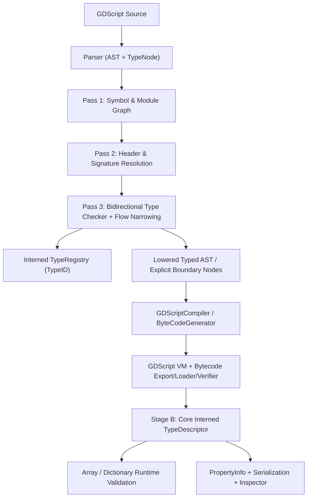

# GDScript Type System Overhaul — Architecture & Design Specification

> [!NOTE]
> This design specifies a staged, backwards-compatible overhaul of GDScript's type system in `cafecito-games/godot`: an interned `TypeID` IR and bidirectional type checker, nested typed collections (static first, then Core runtime reification + serialization + Inspector), zero-cost `Optional[T]` / `T?` with opt-in `strict_null` and Kotlin-style ClassDB platform types (`T!`), control-flow narrowing, and typed `Callable` / `Signal` signatures.

## 1. Executive Summary

GDScript's current type system is fragmented across four incompatible, lossy representations (`GDScriptParser::DataType`, `GDScriptDataType`, Core `ContainerTypeValidate`, and `PropertyInfo`), with ad-hoc expected-type propagation and a flat, non-recursive runtime container model. That fragmentation blocks nested typed collections (`Array[Dictionary[String, int]]`), typed `Callable`/`Signal` signatures, nullable value types, sound nullability checking, and flow-sensitive narrowing.

This specification defines a **backwards-compatible, staged overhaul** that:

1. Replaces GDScript's monolithic `DataType` with a clean, **interned algebraic `TypeID` IR** and a **bidirectional type checker**.
2. Enables **nested typed collections** in two stages: full static typing in GDScript first, followed by **Core runtime reification** (`TypeDescriptor`), serialization, and Inspector support.
3. Introduces **`Optional[T]`** (with **`T?`** shorthand sugar) lowered to a **zero-allocation `T | NIL` runtime representation**, paired with **opt-in `strict_null`** (project-wide, directory-scoped, or per-file) and **Kotlin-style platform types (`T!`)** for unannotated ClassDB / GDExtension / addon boundaries.
4. Adds **control-flow narrowing** (`if x != null`, `if x is SubType`, `match`) and **typed `Callable` / `Signal` signatures**.
5. Preserves **near-zero breakage** for existing GDScript code, third-party addons, GDExtension ABI, and this fork's GDScript bytecode export/loader/verifier pipeline (see [`gdscript-compiled-bytecode-design.md`](gdscript-compiled-bytecode-design.md)).

---

## 2. Goals & Non-Goals

### Goals
- **Single source of truth in GDScript analysis**: Interned `TypeID` with O(1) structural equality and clean separation of *type identity* from *expression/symbol qualifiers*.
- **Full backwards compatibility by default**: Existing untyped and 1-level typed GDScript scripts, third-party addons, and GDExtensions continue compiling and running without modification.
- **Zero-overhead runtime optionality**: `Optional[T]` / `T?` incurs no heap allocation or refcount traffic in the VM.
- **Project-wide `strict_null` ergonomics**: Opting in at project scope works on Day 1 via ClassDB platform types (`T!`) with fail-fast runtime boundary assertions.
- **Bytecode & performance parity**: Full support in `GDScriptBytecodeFormat`, `gdscript_bytecode_export.cpp`, `gdscript_bytecode_loader.cpp`, and `gdscript_bytecode_verifier.cpp`, preserving existing VM inline-cache and container fast paths.
- **Upstream fork hygiene**: Keep new GDScript type-system components modular in dedicated files under `modules/gdscript/` and `core/variant/` with clean, reviewable integration hooks.

### Non-Goals (Deferred to Future Epics)
- User-defined generics (`class Pool[T]`, `func map[T, U](...)`) — *the `TypeID` IR is designed to accommodate `TypeVar` and parametric nominal types cleanly later.*
- Value structs / records and traits / interfaces — *out of scope for this epic, enabled by the same `TypeID` foundation.*
- Breaking changes to un-opted-in legacy scripts or GDExtension C ABI.

---

## 3. Current-State Diagnosis

| Layer | Current Representation | Key Limitations |
|---|---|---|
| **Parser / Analyzer** | `GDScriptParser::DataType` (`modules/gdscript/gdscript_parser.h`) | Mixes type identity, resolver state (`RESOLVING`/`UNRESOLVED`), inference provenance (`TypeSource`), and qualifiers (`is_constant`, `is_read_only`, `is_meta_type`, `is_coroutine`). `operator==` treats `INFERRED` as equal to anything and ignores `container_element_types`. |
| **Compiler / VM / Bytecode** | `GDScriptDataType` (`modules/gdscript/gdscript_function.h`) | Drops enums, callable/signal signatures, optionality, and platform-type metadata. |
| **Core Containers** | `ContainerType` / `ContainerTypeValidate` (`core/variant/container_type_validate.h`) | Flat 3-tuple `(Variant::Type, StringName, Ref<Script>)` embedded in `ArrayPrivate` (`core/variant/array.cpp`) and `DictionaryPrivate` (`core/variant/dictionary.cpp`). Cannot represent nested container types. |
| **Reflection / Inspector / Serialization** | `PropertyInfo` (`core/object/property_info.h`) | Flat `hint_string` conventions (`PROPERTY_HINT_ARRAY_TYPE`, `PROPERTY_HINT_DICTIONARY_TYPE`), mirrored in `core/variant/variant_parser.cpp` and `core/io/resource_format_binary.cpp`. |

---

## 4. Target Architecture



---

## 5. Core Type Model (`TypeID` IR)

### 5.1 Interned `TypeRegistry`
Introduce a lightweight value handle (`struct TypeID { uint32_t index; }`) backed by an arena/intern table (`GDScriptTypeRegistry`) scoped to the compile session / cache.

**Type Nodes (pure type identity only):**

| Kind | Representation | Notes |
|---|---|---|
| `VARIANT` | Singleton | Gradual top/dynamic type |
| `VOID` | Singleton | Function return only |
| `NEVER` | Singleton | Bottom type (`return`, `break`, `continue`, unreachable branches) |
| `NULL_TYPE` | Singleton | Type of literal `null` |
| `BUILTIN` | `Variant::Type` | `bool`, `int`, `float`, `String`, `Vector2`, `Packed*Array`, etc. (excluding `NIL`, `OBJECT`, `ARRAY`, `DICTIONARY`, `CALLABLE`, `SIGNAL` when parameterized) |
| `CLASS` | Unified descriptor (`native_class`, optional `script_ref` / `class_node`) | Replaces split `NATIVE` / `SCRIPT` / `CLASS` special cases |
| `ENUM` | Owner class/script + enum name + value map reference | Distinct from `int`; explicit coercion rules |
| `ARRAY` | `element_type: TypeID` | `Array` (untyped) = `Array[Variant]`; supports arbitrary nesting up to `MAX_TYPE_DEPTH` (32) |
| `DICTIONARY` | `key_type: TypeID`, `value_type: TypeID` | `Dictionary` (untyped) = `Dictionary[Variant, Variant]` |
| `OPTIONAL` | `inner_type: TypeID` | Canonical form of `Optional[T]` and `T?` |
| `PLATFORM` | `inner_type: TypeID` | Internal-only `T!` for unannotated ClassDB / GDExtension / non-strict boundaries |
| `CALLABLE` | `parameter_types: Span<TypeID>`, `required_parameter_count: uint16_t`, `return_type: TypeID`, `is_vararg: bool` | Bare `Callable` = untyped callable |
| `SIGNAL` | `parameter_types: Span<TypeID>` | Bare `Signal` = untyped signal |

**Non-type metadata moved OUT of `TypeID`** onto `ExpressionInfo` / `SymbolInfo`:
- `TypeSource` (`UNDETECTED`, `INFERRED`, `ANNOTATED_EXPLICIT`, `ANNOTATED_INFERRED`)
- `is_constant`, `is_read_only`, `is_type_value` (replacing `is_meta_type`), `is_pseudo_type`, `is_coroutine`, `is_late_init` (`@onready` / `@export_required`)

### 5.2 Subtyping, Variance, and Coercions
Replace `check_type_compatibility()` (`modules/gdscript/gdscript_analyzer.cpp`) with three distinct relations:

1. **Subtyping (`is_subtype(source, target)`)**:
   - `NEVER <: T` for all `T`.
   - `ClassSub <: ClassBase` via unified native + script inheritance chain.
   - `T <: Optional[T]` and `NULL_TYPE <: Optional[T]`.
   - `Optional[A] <: Optional[B]` iff `A <: B` (**covariant**).
   - `Array[A] <: Array[B]` iff `A == B` (**invariant** for mutable containers).
   - `Dictionary[K1, V1] <: Dictionary[K2, V2]` iff `K1 == K2` and `V1 == V2` (**invariant**).
   - `Callable[(P1...) -> R1] <: Callable[(P2...) -> R2]` iff parameters are **contravariant** (`P2_i <: P1_i`, respecting default parameter counts) and return type is **covariant** (`R1 <: R2`).
   - `Signal[(P1...)] <: Signal[(P2...)]` iff `P1 == P2` (invariant on storage; handler parameter contravariance on `connect`, argument subtyping on `emit`).
2. **Implicit Coercion (`can_coerce(source, target)`)**:
   - Kept explicit and separate from subtyping: `int -> float`, `String <-> StringName`, `String <-> NodePath`, `Enum -> int`, and (configurable warning/error) `int -> Enum`.
   - Every implicit coercion records a lowered coercion marker so codegen never guesses.
3. **Gradual Typing Boundary (`Variant` ↔ Static)**:
   - `Variant` is assignable to/from any type, but `Variant -> Static` explicitly marks a **checked boundary** (emitting unsafe-line diagnostics when warnings are enabled and emitting a runtime check in bytecode).
   - Untyped `Array` / `Dictionary` remain gradually compatible with typed `Array[T]` / `Dictionary[K, V]` across assignment (with runtime validation / conversion), preserving existing GDScript behavior.

---

## 6. Feature Specifications

### 6.1 Bidirectional Type Checking & Inference
Implement standard two-mode checking in `GDScriptAnalyzer`:
- **`synthesize_type(node) -> TypeID`**: Infers a node's type bottom-up when no expected type is supplied.
- **`check_type(node, expected_type) -> TypeID`**: Propagates `expected_type` top-down into:
  - Nested array & dictionary literals (`var grid: Array[Dictionary[String, int]] = [{"a": 1}]`)
  - Lambda expressions (`items.filter(func(item): return item.health > 0)` infers `item` and return type from the expected `Callable`)
  - Ternary expressions (`condition ? a : b`)
  - `Optional[T]` / `null` literals (`var count: int? = null`)
  - Function call arguments, `return` statements, assignments, variable initializers, and casts

This deletes the 10+ duplicated `has_container_element_type()` propagation branches currently scattered across `modules/gdscript/gdscript_analyzer.cpp`.

---

### 6.2 Nested Typed Collections (Staged)

#### Syntax
Remove the parser error `"Nested typed collections are not supported."` in `modules/gdscript/gdscript_parser.cpp` (`parse_type()`) and allow recursive `TypeNode` parameter lists up to `GDScriptBytecodeFormat::MAX_TYPE_DEPTH` (32):

```gdscript
var inventory: Dictionary[String, Array[ItemData]] = {}
var matrix: Array[Array[float]] = [[1.0, 2.0]]
var table: Array[Dictionary[String, int?]] = [{"hp": 100, "mp": null}]
```

#### Stage A — Static Typing in GDScript (Milestone 2)
- Full compile-time checking of nested `Array[...]` and `Dictionary[..., ...]` across variables, parameters, returns, indexing (`table[0]["hp"]` has type `int?`), built-in container methods (`back()`, `front()`, `get()`, `values()`, `keys()`, `pop_back()`, etc.), and `for` loops.
- At runtime in Stage A, `Array::set_typed()` / `Dictionary::set_typed()` continues enforcing the **outermost** layer (`Array[Dictionary]`, `Dictionary[String, Array]`).
- Crossing from untyped `Variant`/`Array`/`Dictionary` into a nested typed variable validates the outer layer at runtime and emits a clear gradual-boundary warning if strict warnings are enabled.

#### Stage B — Core Runtime Reification, Serialization & Inspector (Milestone 6)
Replace flat `ContainerTypeValidate` with an **interned Core `TypeDescriptor`** in `core/variant/`:

```cpp
struct TypeDescriptor {
	enum Kind : uint8_t {
		ANY,        // Variant
		BUILTIN,    // Variant::Type (non-container, non-Object)
		OBJECT,     // class_name + optional Ref<Script>
		ARRAY,      // element: const TypeDescriptor *
		DICTIONARY, // key: const TypeDescriptor *, value: const TypeDescriptor *
		OPTIONAL,   // inner: const TypeDescriptor *
	};
	// Interned in Core TypeDescriptorRegistry; immutable once constructed.
};
```

- **Performance**: `ArrayPrivate` and `DictionaryPrivate` store a single `const TypeDescriptor *` (replacing `{Variant::Type, StringName, Ref<Script>}`). Exact container type compatibility on assignment/insertion is **O(1) pointer equality** (`left.descriptor == right.descriptor`).
- **Backwards-compatible Core / GDExtension API**: Keep `Array::get_typed_builtin()`, `get_typed_class_name()`, `get_typed_script()`, `set_typed(uint32_t, StringName, Variant)` (and `Dictionary` equivalents) as shims delegating to the root `TypeDescriptor`, while adding recursive `get_type_descriptor()` / `set_type_descriptor()` APIs.
- **Recursive `PropertyInfo` & Serialization**:
  - Preserve 1-level `PROPERTY_HINT_ARRAY_TYPE` / `PROPERTY_HINT_DICTIONARY_TYPE` hint strings for existing scenes and addons.
  - Introduce a canonical recursive descriptor grammar (or structured field on `PropertyInfo`) used only when nesting depth > 1 or `Optional[T]` is exported.
  - Update `core/variant/variant_parser.cpp` (`.tscn`/`.tres`), `core/io/resource_format_binary.cpp`, and `editor/inspector/editor_properties_array_dict.cpp` for recursive Inspector editing.

---

### 6.3 `Optional[T]` / `T?`, Opt-In `strict_null`, and Platform Types (`T!`)

#### Syntax & Canonical Form
- `Optional[T]` is the canonical type name; `T?` is syntactic sugar that parses to the exact same `TypeID` (`Optional(T)`).
- **Illegal forms** (compile-time errors):
  - `Optional[Variant]` / `Variant?` (`Variant` already includes `null`)
  - `Optional[void]` / `void?`
  - `Optional[Optional[T]]` / `T??` (nested optionals are disallowed so zero-cost `T | NIL` lowering remains unambiguous)

#### Zero-Allocation Runtime Representation
At runtime in the GDScript VM, `Optional[T]` is stored directly in a `Variant`:
- `None` → `Variant::NIL` (`null`)
- `Some(value)` → the `Variant` holding `value` directly (no wrapper object, no heap allocation, no refcounting)

#### Built-In Ergonomic Operations on `Optional[T]`
Because `Optional[T]` is a first-class language type (lowered directly by the compiler to inline bytecode, not dynamic method dispatch on a wrapper object):

| Operation | Behavior |
|---|---|
| `Optional.none()` or `null` (when expected type is `Optional[T]`) | Produces `None` (`Variant::NIL`) |
| `Optional.of(value)` | Normalizes `null` → `None`; otherwise `Some(value)` (prevents `Some(null)`) |
| `Optional.of_valid(object)` | For `Object` types: returns `None` if `object == null` or `!is_instance_valid(object)` |
| `optional.is_some() -> bool` / `optional.is_none() -> bool` | Inline `Variant::NIL` check; participates in control-flow narrowing |
| `optional.unwrap() -> T` | Returns `T` or triggers a runtime error with line/expression info if `None` |
| `optional.unwrap_or(fallback: T) -> T` | Returns `T` or `fallback` |
| `optional.unwrap_or_else(provider: Callable[() -> T]) -> T` | Lazy fallback evaluation |
| `optional.map(transform: Callable[(T) -> U]) -> Optional[U]` | Applies `transform` if `Some`, else returns `None` |
| `optional.and_then(transform: Callable[(T) -> Optional[U]]) -> Optional[U]` | Monadic flat-map |

Direct member/method access on `Optional[T]` (e.g., `maybe_node.position`) is a **compile-time error** until unwrapped or narrowed.

#### Opt-In `strict_null` Scoping
Default behavior (`strict_null = false`) keeps `Object` types nullable for 100% backwards compatibility while still allowing `Optional[T]` / `T?` everywhere.

When enabled, plain `Object` types (e.g., `Node`, `MyEnemy`) become **non-nullable**:
- **Project settings**:
  - `debug/gdscript/typing/strict_nullability` (`bool`, default `false`)
  - `debug/gdscript/typing/strict_nullability_exclude_paths` (`PackedStringArray`, default `["res://addons/"]`)
- **Per-file override annotations** (at file top):
  - `@strict_null` — enables strict nullability for this file even when project setting is off
  - `@no_strict_null` — opts a specific file out when project setting is on

#### Kotlin-Style Platform Types (`T!`) for Unannotated Boundaries
Under `strict_null`, any `Object` type originating from:
- Unannotated ClassDB methods/properties
- GDExtension classes
- Non-strict GDScript files (e.g., `res://addons/`)

is typed internally as a **platform type `Platform(T)`** (displayed as `Node!` in diagnostics/hover tooltips).

Rules for `T!`:
1. **Assigning `T!` → `Optional[T]`**: Allowed, safe, zero extra check.
2. **Assigning `T!` → `T` (non-null)** or **direct member access on `T!`**: Allowed statically; compiler emits a **fail-fast runtime null-assertion** (`OPCODE_ASSERT_NOT_NULL`) right at the boundary so `null` can never silently leak into a non-null `T` slot.
3. **Passing to a `T!` parameter**: Accepts `T`, `Optional[T]`, or `null`.
4. **Inference (`:=`)**:
   - Local `var parent := get_parent()` silently preserves `Node!` (exact Kotlin behavior) with fail-fast runtime null checks on dereference or non-null assignment.
   - Add `PLATFORM_TYPE_INFERRED` to `GDScriptWarning` (default `IGNORE`, configurable to `WARN` or `ERROR` in `project.godot`) for teams that want every platform boundary explicitly annotated.
   - Class member properties and inferred function return types must resolve to explicit `T` or `Optional[T]`—`T!` must never leak across script API boundaries.
5. **Incremental ClassDB Nullability Table**:
   - Ship a curated, extensible ClassDB nullability metadata table (initially covering high-frequency nullable methods like `Node.get_node_or_null`, `Node.find_child`, `Node.get_parent`, `Node.get_tree`, `ResourceLoader.load`, `ClassDB.instantiate`, `SceneTree.get_first_node_in_group`, etc.) that upgrades those methods from `T!` directly to `Optional[T]` or non-null `T`.

#### Godot Lifecycle Idioms under `strict_null`
- **`@onready var sprite: Sprite2D = $Sprite2D`**: Treated as late-initialized (`is_late_init`). Allowed to be non-null; reading before `_ready()` or resolving `$Sprite2D` to `null` fails fast with a clear runtime error.
- **`@export` vs. `@export_required` under `strict_null`**:
  - Plain `@export` on an `Object` property without a default value requires `Optional[T]` / `T?` (explicitly optional Inspector slot).
  - `@export_required var health: HealthComponent` allows a non-null `Object` type, reuses the same `is_late_init` mechanism as `@onready`, fails fast in `_ready()` if left unassigned, and surfaces an Editor configuration warning when a scene instance leaves it empty.
- **Non-null member variables without `@onready` / `@export_required`**: Must have an initializer expression or be assigned in `_init()` before `self` escapes.

---

### 6.4 Control-Flow Narrowing
Track a scoped `FlowTypeEnv` (`Symbol -> Narrowed TypeID`) across control-flow graphs in function bodies:

- **Supported narrowing predicates**:
  - `x != null` / `x == null` (narrows `Optional[T]` → `T` in the non-null branch, `NULL_TYPE` in the null branch)
  - `x.is_some()` / `x.is_none()`
  - `x is SubType` (narrows `Base` / `Variant` / `Optional[Base]` → `SubType`)
  - `is_instance_valid(x)` (narrows `Optional[T]` / `T!` → `T`)
- **Control-flow propagation**:
  - `if` / `elif` / `else` branches
  - Short-circuit boolean expressions (`x != null and x.visible`, `x == null or x.is_empty()`)
  - Ternary expressions (`x.health if x != null else 0`)
  - Early exits (`if x == null: return` narrows `x` to `T` for the remainder of the block)
  - `match` patterns (`match optional_value: null: ...; var value: ...`)
  - **No narrowing from `assert()`**: Because Godot strips `assert()` in release builds (`!DEBUG_ENABLED`), `assert(x != null)` and `assert(x is Enemy)` deliberately do **not** narrow `x`. When a user writes `assert(x != null)` followed by an unnarrowed dereference under `strict_null`, the diagnostic explicitly suggests `if x == null: return` or `x.unwrap()`.
- **Soundness invalidation rules**:
  - Reassigning a narrowed local variable resets/updates its narrowed type.
  - Narrowing of **local variables** (not captured mutably by a lambda) stays valid across function calls.
  - Narrowing of **member properties** (`self.target`) is invalidated after any non-pure function call or assignment that could mutate `self`, with a clear diagnostic suggesting `var target := self.target` to capture locally.

---

### 6.5 Typed `Callable` & `Signal` Signatures

#### Syntax
```gdscript
var predicate: Callable[(Enemy) -> bool] = func(enemy): return enemy.health > 0
var on_done: Callable[() -> void] = _handle_done
var damage_signal: Signal[(int, Node)]
```
- Bare `Callable` and `Signal` remain valid untyped/gradual equivalents.
- Trailing default parameters are tracked via `required_parameter_count`, so `Callable[(int, String = "") -> void]` is assignable to `Callable[(int) -> void]`.

#### Checking & Inference
- **Bidirectional lambda inference**: Assigning `func(enemy): return enemy.health > 0` to `Callable[(Enemy) -> bool]` automatically types `enemy` as `Enemy` and checks the return expression against `bool`.
- **Method references**: `self._on_hit` synthesizes its exact `Callable[(...)->...]` signature from the method declaration.
- **Checked calls & connections**:
  - `predicate.call(enemy)` checks argument count, types, and synthesizes `bool` as the call's return type.
  - `predicate.bind(...)` computes the resulting partially applied `Callable` signature where statically known.
  - `damage_signal.emit(10, attacker)` and `damage_signal.connect(handler)` validate argument/handler signatures against `Signal[(int, Node)]`.
- **Runtime behavior**:
  - Statically enforced in GDScript; `Callable` / `Signal` remain standard Godot `Variant::CALLABLE` / `Variant::SIGNAL` at runtime (zero overhead on dispatch, preserving existing signal dispatch fast paths).

---

## 7. VM, Bytecode Format, Verifier & Tooling Integration

Because this fork ships a full GDScript bytecode export/loader/verifier pipeline, every type-system change must stay lockstep with:

1. **Bytecode Format (`modules/gdscript/gdscript_bytecode_format.h`)**:
   - Bump `FORMAT_VERSION` (`1 -> 2`) when adding new `GDScriptDataType` flags/kinds (`OPTIONAL`) and new opcodes.
   - `MAX_TYPE_DEPTH = 32` is already enforced by `read_data_type()` (`modules/gdscript/gdscript_bytecode_loader.cpp`) and `write_data_type()` (`modules/gdscript/gdscript_bytecode_export.cpp`). Relax the shape check in both files to permit nested `ARRAY`/`DICTIONARY` `container_element_types` up to `MAX_TYPE_DEPTH` and add `OPTIONAL` support.
   - In Stage B, extend `read_container_type()` / `write_container_type()` to serialize recursive `TypeDescriptor` trees (bounded by `MAX_TYPE_DEPTH`).
2. **New VM Opcodes (`modules/gdscript/gdscript_opcode_layout.inc`, `gdscript_bytecode_abi_builder.py`, `gdscript_bytecode_verifier.cpp`)**:
   - `OPCODE_ASSERT_NOT_NULL` (for `T! -> T` boundary checks, `@onready`/`@export_required` late-init checks, and `.unwrap()`): fast `Variant::NIL` check with line-mapped runtime error.
   - Inline lowering for `Optional` methods (`.is_some()`, `.is_none()`, `.unwrap_or()`) using existing branch/assign opcodes—no dynamic call overhead.
3. **Editor, LSP & DocGen**:
   - Update completion and hover types in `modules/gdscript/gdscript_editor.cpp` and `modules/gdscript/language_server/` to display `Array[Dictionary[String, int]]`, `Optional[T]` / `T?`, `T!`, and `Callable[(...) -> ...]`, and to respect narrowed types inside `if`/`match` blocks.
   - Update `modules/gdscript/editor/gdscript_docgen.cpp` to emit readable recursive container, optional, and callable/signal signatures.

---

## 8. Backwards Compatibility Matrix

| Scenario | Legacy Mode (`strict_null = false`) | Strict Mode (`strict_null = true`) |
|---|---|---|
| Existing untyped GDScript (`var x = ...`) | 100% compatible | 100% compatible (gradual `Variant`) |
| Existing 1-level typed collections (`Array[int]`) | 100% compatible | 100% compatible |
| Existing `var n: Node = null` | 100% compatible | Compile error → use `Optional[Node]` / `Node?` |
| Third-party addons in `res://addons/` | 100% compatible | Excluded by default (`T!` platform types at boundary) |
| ClassDB calls (`get_node_or_null`, `get_tree`) | 100% compatible | Platform types `T!` + curated nullability table |
| Existing `.tscn` / `.tres` scenes | 100% compatible | 100% compatible (new format only for nested exports) |
| Existing GDExtensions (C ABI) | 100% compatible (1-level shims preserved) | 100% compatible |

---

## 9. Proposed Epic Breakdown (Milestones & Issues)

Each milestone is shippable, independently testable, and leaves the tree green.

### Milestone 1 — Foundation: Interned `TypeID` IR & Bidirectional Checker
- **1.1**: Introduce `GDScriptTypeRegistry` and `TypeID` (pure type identity separated from expression/symbol qualifiers) with unit tests for interning, structural equality, recursion limits, and subtyping/variance.
- **1.2**: Migrate `GDScriptParser::DataType` consumers in `GDScriptAnalyzer` to `TypeID` + `ExpressionInfo`, fixing `INFERRED` equality bugs and separating `is_subtype` vs. `can_coerce` vs. gradual boundaries.
- **1.3**: Refactor `GDScriptAnalyzer` expression checking to bidirectional (`synthesize_type` / `check_type`), removing duplicated container-literal propagation sites.

### Milestone 2 — Nested Typed Collections (Stage A: Static GDScript)
- **2.1**: Remove nested collection restriction in `GDScriptParser::parse_type()` (bounded by `MAX_TYPE_DEPTH = 32`) and support arbitrary nested `Array[...]` / `Dictionary[..., ...]` in `GDScriptAnalyzer` (literals, indexing, `for` loops, builtin container methods).
- **2.2**: Update `GDScriptCompiler`, `GDScriptDataType`, bytecode export/loader/verifier (`FORMAT_VERSION = 2`), LSP/completion, and docgen for recursive container types (outermost runtime enforcement).

### Milestone 3 — `Optional[T]` / `T?`, `strict_null`, and ClassDB Platform Types (`T!`)
- **3.1**: Parse `Optional[T]` and `T?` sugar into `TypeID::OPTIONAL`; reject invalid forms (`Variant?`, `void?`, `T??`); implement zero-cost `T | NIL` lowering and inline `.is_some()`, `.is_none()`, `.unwrap()`, `.unwrap_or()`, `.unwrap_or_else()`, `.map()`, `.and_then()`, `Optional.of()`, `Optional.of_valid()`, `Optional.none()`.
- **3.2**: Add `OPCODE_ASSERT_NOT_NULL` across `gdscript_opcode_layout.inc`, VM, disassembler, bytecode export/loader/verifier, and ABI builder.
- **3.3**: Implement `strict_nullability` project setting, exclude path globs (`res://addons/`), `@strict_null` / `@no_strict_null` annotations, `@onready` late-init checks, and `@export` / `@export_required` rules (with Editor configuration warnings for unassigned `@export_required`).
- **3.4**: Implement `Platform(T)` (`T!`) boundary semantics for ClassDB, GDExtension, and non-strict scripts, `PLATFORM_TYPE_INFERRED` warning (default `IGNORE`), plus the curated initial ClassDB nullability metadata table.

### Milestone 4 — Control-Flow Narrowing
- **4.1**: Implement `FlowTypeEnv` narrowing in `GDScriptAnalyzer` for `if`/`elif`/`else`, short-circuit `and`/`or`, ternary, early returns, and `match` patterns (`!= null`, `is_some()`, `is SubType`, `is_instance_valid()`), deliberately excluding stripped `assert()` with actionable diagnostics.
- **4.2**: Implement soundness invalidation rules (reassignment, mutable captures, member property calls) and wire narrowed types into `GDScriptCompiler` (eliminating redundant runtime casts) and editor/LSP autocompletion.

### Milestone 5 — Typed `Callable` & `Signal` Signatures
- **5.1**: Parse and intern `Callable[(P...) -> R]` and `Signal[(P...)]` types, including variance rules and default parameter arity.
- **5.2**: Implement bidirectional lambda parameter/return inference, typed method references, checked `.call()` / `.bind()` / `.emit()` / `.connect()`, and LSP/docgen support.

### Milestone 6 — Nested Typed Collections (Stage B: Core Runtime Reification)
- **6.1**: Implement interned Core `TypeDescriptor` and `TypeDescriptorRegistry` in `core/variant/`, migrating `ArrayPrivate` and `DictionaryPrivate` from flat `ContainerTypeValidate` while preserving 1-level C++ / GDExtension compatibility shims.
- **6.2**: Wire recursive `TypeDescriptor` into GDScript VM runtime container creation, assignment validation, and `GDScriptBytecodeFormat` constant container serialization.
- **6.3**: Add recursive `PropertyInfo` descriptor encoding, `.tscn`/`.tres` (`VariantParser`) and binary (`ResourceFormatBinary`) serialization, and recursive Inspector editing in `EditorPropertiesArrayDict`.

---

## 10. Verification & Testing Strategy

- **GDScript test suite (`modules/gdscript/tests/`)**:
  - Parser/analyzer positive & error golden tests for every milestone (nested collections, `Optional[T]` / `T?`, `strict_null`, `T!`, `@export_required`, narrowing, invalidation, typed `Callable`/`Signal`).
  - Runtime tests verifying zero-alloc `Optional[T]` behavior, fail-fast `OPCODE_ASSERT_NOT_NULL` errors at `T! -> T` boundaries, `@onready`/`@export_required` guards, and Stage B recursive `Array`/`Dictionary` mutation rejection.
  - Bytecode round-trip & verifier fuzz/shape tests in `modules/gdscript/tests/test_gdscript_bytecode.h` (including `MAX_TYPE_DEPTH` boundary tests and malformed bytecode rejection).
- **Core & Serialization tests**:
  - Round-trip `.tscn`/`.tres` and binary `.res` tests for nested typed collections and exported `Optional[T]` properties.
  - Regression test running the full existing GDScript test suite in legacy mode (`strict_null = false`) with zero regressions (`bin/godot.macos.editor.arm64 --headless --test --test-suite="*GDScript*"`).
- **Performance benchmarks (`cafecito/benchmarks/gdscript/`)**:
  - Verify no regression in GDScript VM container, call, and member-access benchmarks (confirming `Optional[T]` adds zero allocations and Stage B `TypeDescriptor*` comparison stays O(1)).

---

## 11. Confirmed Design Decisions

1. **No narrowing from `assert()`**: Godot strips `assert()` in release builds; narrowing relies exclusively on release-active control flow (`if x == null: return`, `x.unwrap()`, `match`) so release builds never violate type soundness or silently retain debug assertions.
2. **Local `Node!` inference + opt-in warning**: Under `strict_null`, local `:=` inference preserves `Node!` silently (Kotlin behavior) with fail-fast runtime checks on non-null consumption, forbids `Node!` on member/return API boundaries, and exposes `PLATFORM_TYPE_INFERRED` (default `IGNORE`, configurable to `WARN`/`ERROR`).
3. **`@export_required` alongside `@export var target: Node?`**: Plain `@export` without a default requires `Optional[T]` / `T?`; `@export_required` enables non-null Inspector-wired references with `is_late_init` runtime validation at `_ready()` and Editor configuration warnings when unassigned.
